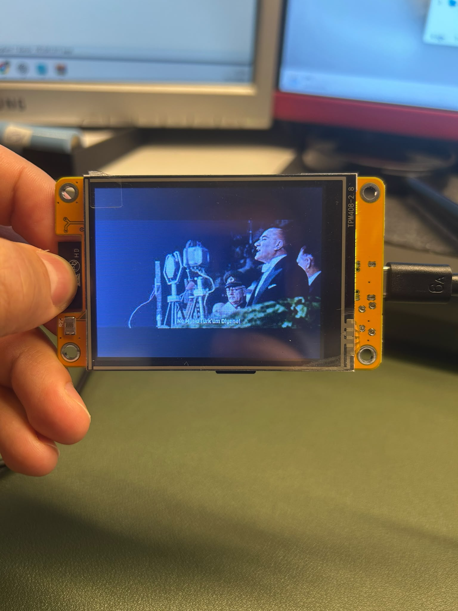
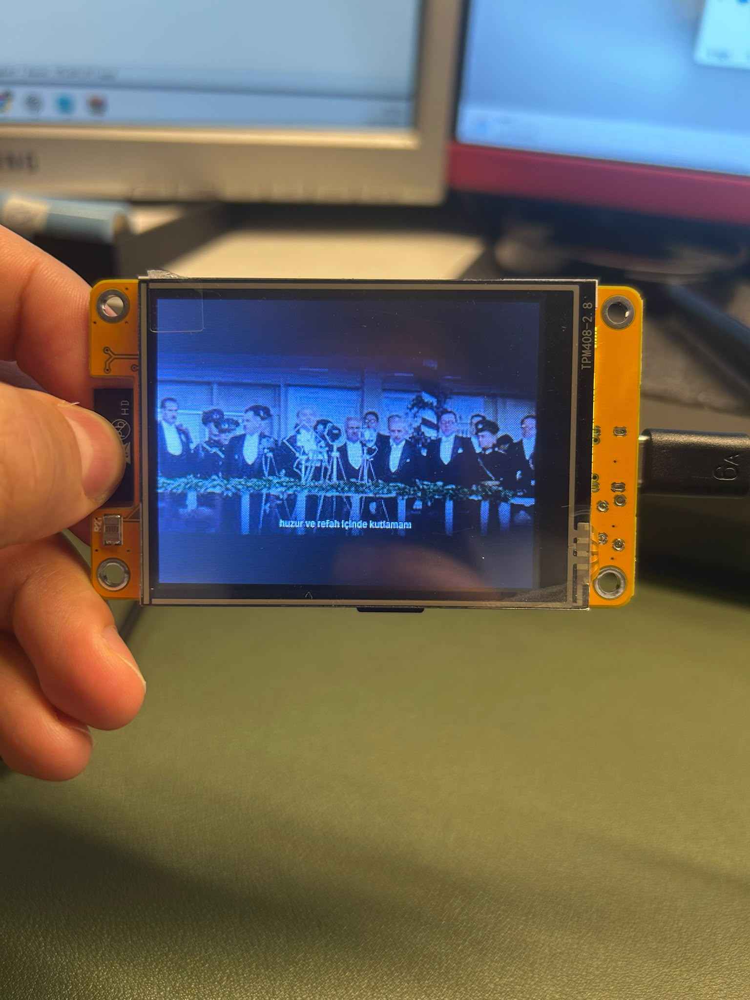

# Fmpeg Converter v1

**The Mechatronic Workshop** tarafından geliştirilen Windows video dönüştürme ve ekran önizleme aracı.

## Özellikler
- MP4, MOV, MKV, AVI ve FFmpeg destekli diğer videolar
- MJPEG (`.mjpeg`) çıktı
- ESP32 CYD, TFT/LCD, HDMI/Monitor, OLED/AMOLED ve özel çözünürlük profilleri
- Sığdır, Doldur, Esnet; döndürme, FPS ve JPEG kalite ayarları
- Hedef ekran ve dönüştürülmüş MJPEG önizlemesi (ilk 6 saniye)

## Kurulum ve kullanım
1. [Releases](../../releases) bölümünden **v1** Windows paketini indirin (yayınlandığında).
2. Arşivi tamamen çıkarın; `engine` klasörü uygulamayla aynı dizinde kalmalıdır.
3. `Fmpeg Converter.exe` dosyasını açın.
4. Kaynak video ve MJPEG çıktı yolunu seçin.
5. Çözünürlük, yerleşim, döndürme, FPS ve kaliteyi ayarlayın.
6. **HEDEF ÖNİZLEME** ve **MJPEG DÖNÜŞTÜR** seçeneklerini kullanın.

Windows PowerShell 5.1 ve Windows Forms gerektirir. Python gerekmez.

## ESP32 CYD
ESP32-2432S028 için örnek çözünürlük: dikey 240×320 veya yatay 320×240. Başlangıç için 20 FPS ve JPEG kalite 7 deneyebilirsiniz.


## ESP32 CYD — Gerçek Cihaz Görüntüleri

Fmpeg Converter ile hazırlanan MJPEG videonun ESP32-2432S028 (CYD) ekranında oynatılmasından örnekler:

<table>
<tr>
<td width="50%"></td>
<td width="50%"></td>
</tr>
</table>

> Fotoğraflar gerçek donanımdan alınmıştır. Ekrandaki renkler ve görüntü kalitesi kullanılan panel ve video ayarlarına bağlıdır.

## ESP32 CYD — Negatif Renk Düzeltmesi

Bazı **ESP32-2432S028 (CYD)** ekranlarında video renkleri negatif (ters) görünebilir. Arduino video oynatıcı kodunda, ekran başlatıldıktan sonra şu ayarı kullanabilirsiniz:

```cpp
gfx->invertDisplay(true);  // Negatif görünen renkleri düzeltir (uyumlu panellerde)
```

Orijinal kodda satır yorum içindeyse başındaki `//` işaretini kaldırın:

```cpp
// gfx->invertDisplay(true);  // Eski: devre dışı
gfx->invertDisplay(true);     // Yeni: etkin
```

Yatay ekran kullanıyorsanız ekran dönüşünü de ayarlayın:

```cpp
gfx->setRotation(1);       // Yatay: 320x240
gfx->invertDisplay(true);  // Renk terslemesini etkinleştir
```

> **Not:** Renk tersleme ihtiyacı panel sürümüne göre değişir. Renkler zaten doğruysa `invertDisplay(false)` kullanın veya satırı kaldırın. `setRotation(1)` ekran yönünü değiştirir; videonun kendi yönünü otomatik düzeltmez. Yatay oynatma için MJPEG videoyu da **320×240** olarak dönüştürün. Ekran ters tarafta kalırsa `setRotation(3)` deneyin.

## Teşekkür ve Referanslar

ESP32-2432S028 (CYD) üzerinde MJPEG video oynatma konusunda paylaştığı açık kaynak çalışması ve öğretici video için **The Last Outpost Workshop**'a teşekkür ederiz.

- **Orijinal ESP32 video oynatıcı projesi:** [thelastoutpostworkshop/esp32-2432S028_video_player](https://github.com/thelastoutpostworkshop/esp32-2432S028_video_player)
- **YouTube anlatımı:** [ESP32 video oynatıcı videosu](https://www.youtube.com/watch?v=jYcxUgxz9ks)

Fmpeg Converter, videoları uygun biçime dönüştürmek için hazırlanmış ayrı bir Windows aracıdır. ESP32 üzerinde video oynatma tarafında yukarıdaki çalışmadan yararlanılmıştır. **Bu depo, orijinal geliştiriciyle resmî bağlantılı veya onun tarafından onaylanmış değildir.**

## Notlar
- Bu **v1 önizleme sürümüdür**; kapsamlı Windows testi yapılmamıştır.
- Çıktı MJPEG'dir, ses içermez. HDMI profili HDMI sinyali üretmez.
- Önizleme gerçek panel renklerini birebir garanti etmez.
- FFmpeg lisans ve kaynak kod yükümlülükleri için: https://ffmpeg.org/legal.html
- Proje kaynak kodu için henüz ayrı bir lisans belirtilmemiştir.

**The Mechatronic Workshop**